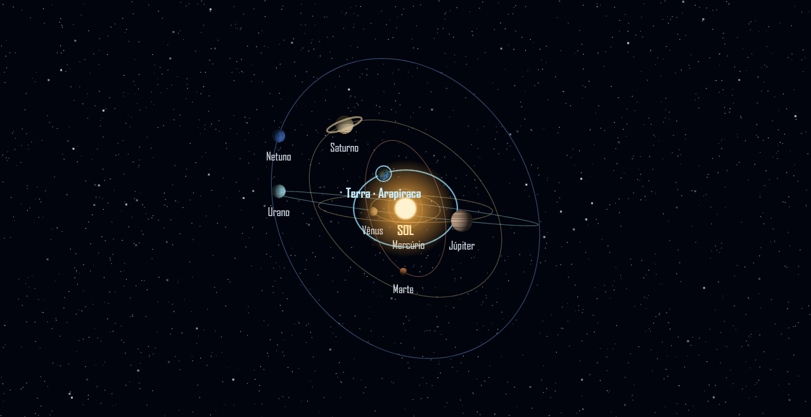

# Céu compartilhado com o PREPARATÓRIO

Implementação da [Issue #2](https://github.com/romariovicente/JARV-IA/issues/2).

A entrada pública é `index.html` na raiz → `src/main.jsx` → `src/App.jsx`.
As variantes históricas em `frontend/` e `projeto-3d/` continuam preservadas;
elas não são a entrada do build da raiz.

O painel ativo usa o Sol central e os oito planetas, com texturas procedurais,
órbitas inclinadas, anéis de Saturno e identificação da Terra/Arapiraca. O
modelo público em `functions/world-clock-config.json` contém a configuração
`PREP_SOLAR_SKY_20261005` copiada do jogo: mesma época UTC, mesma duração de
órbita de 120 segundos, rotação, cores, continentes e parâmetros planetários.
As três vistas mudam somente a câmera. Abrir outra aba ou renderizar com outra
taxa de quadros não reinicia nem acelera as órbitas.

É uma projeção didática com escalas e velocidades adaptadas. Não representa
uma efeméride astronômica nem uma reprodução fotográfica do sistema solar.

## Publicação do site

1. Executar `npm ci` e `npm run check` na raiz com Node.js 24.
2. Abrir um PR vinculado à Issue #2. O workflow `pages.yml` valida estrutura,
   relógio, desenho e build nos PRs, sem publicar o código do PR.
3. Após o merge validado, escolher **GitHub Actions** como origem do GitHub
   Pages. O workflow publica somente o diretório compilado `dist/`.

O `base: './'` mantém os assets relativos para o caminho `/JARV-IA/`.
Não publicar o diretório do código-fonte: o navegador não compila JSX.
`dist/` é um artefato gerado em CI e não precisa estar versionado.

## Horário compartilhado e limite atual

Sem `VITE_WORLD_CLOCK_URL`, o painel mostra explicitamente **horário deste
dispositivo · Brasília**. Isso preserva a mesma fase para o mesmo instante UTC,
mas não comprova sincronização de dois aparelhos com relógios desajustados.

O código contém um endpoint público sem chaves ou dados de usuários:

- Desenvolvimento Express: `GET /api/world-clock` (servidor local).
- Firebase opcional: função `worldClock`, região `southamerica-east1`, com
  rewrite `GET /api/world-clock` na configuração do Hosting.

Nenhum projeto Firebase ou serviço pago foi criado ou implantado por esta
alteração. O GitHub Pages não executa essas funções. Para ativar sincronização
remota, publicar o endpoint em um serviço já autorizado, testar sua resposta e
configurar a mesma URL HTTPS no jogo e no JARV-IA. No build Pages, a variável
de repositório `WORLD_CLOCK_URL` alimenta `VITE_WORLD_CLOCK_URL`. Ela é uma URL
pública, nunca uma chave de API.

O cliente verifica versão, fuso, época, velocidades e centro orbital antes de
aceitar a resposta. Usa uma âncora monotônica com compensação de meia latência;
se a conexão cair, identifica a última sincronização. Se o contrato divergir,
permanece identificado como relógio do dispositivo. O desenho e o relógio do
painel leem o mesmo cliente.

## Validação deste incremento

`npm run check` passou: validação das entradas, 15 testes de relógio/contrato/
projeção e build Vite. A prévia acima foi renderizada offline com o mesmo
desenhador usado em produção; não substitui o teste final da página publicada.
Os fluxos e mensagens do chat existente não foram reescritos. O backend de
chat continua precisando da implantação/configuração próprias; este PR não
declara autenticação, IA externa ou comunicação multiplayer operacionais.

O script Auto-Heal teve uma chave de fallback removida do código e passou a
usar somente `GROQ_API_KEY` do ambiente. Os imports foram ajustados ao modo ESM
do projeto. A chave anteriormente publicada deve ser revogada/rotacionada no
provedor: remover a linha atual não apaga o histórico Git. O teste de guarda
confirma que, sem o secret, o script encerra antes de ler/enviar o código; não
houve execução de chamadas de IA ou modificações automáticas por esse agente.
